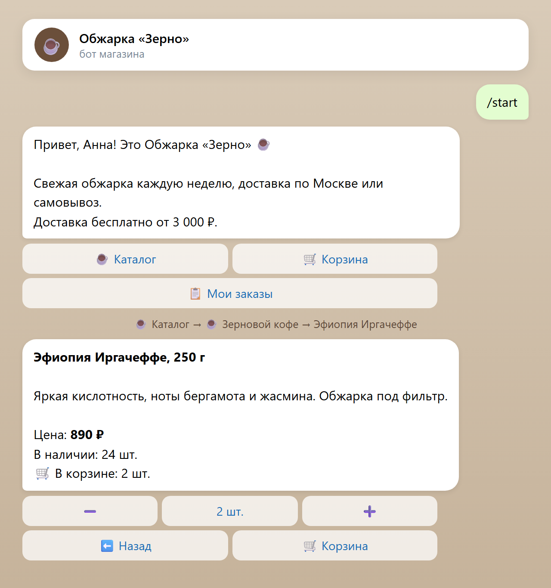
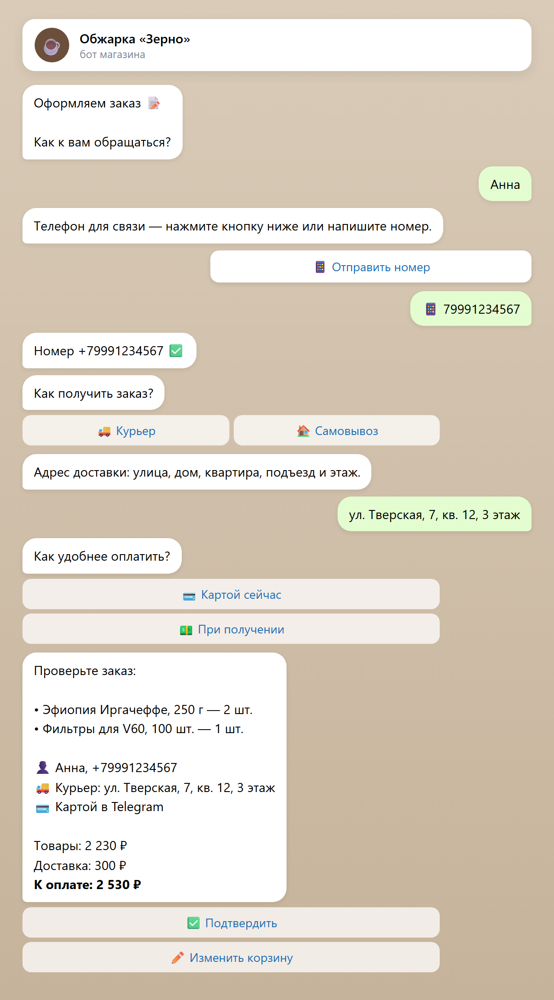
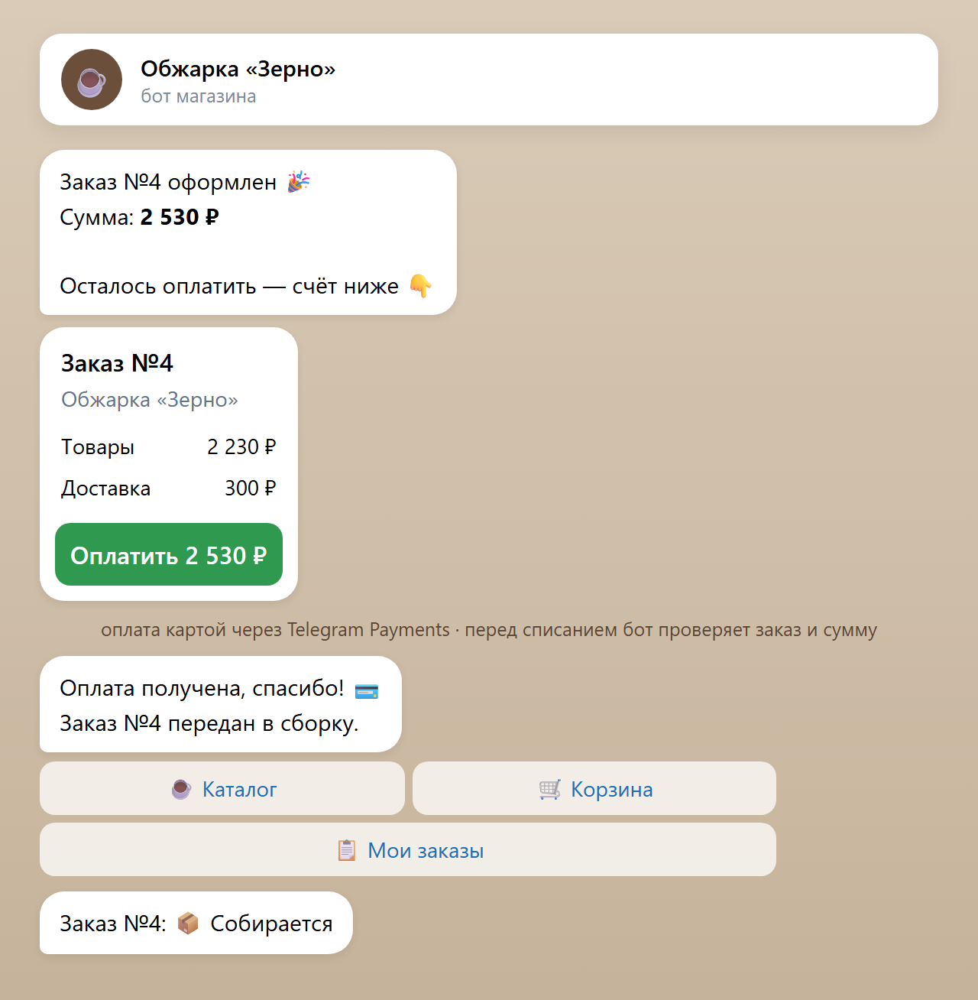
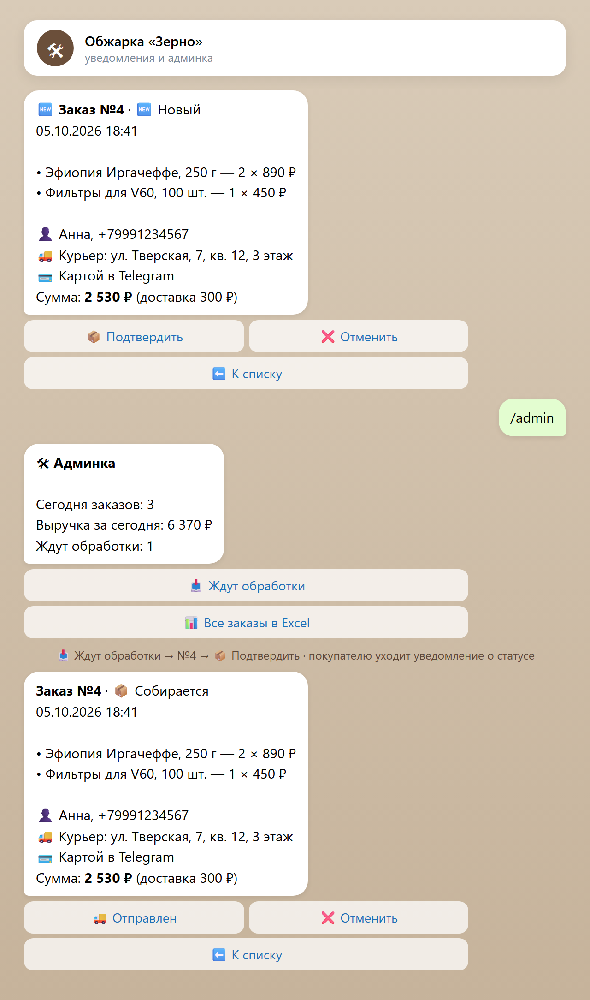
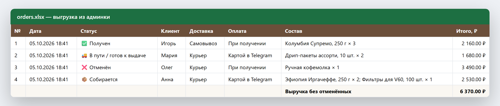
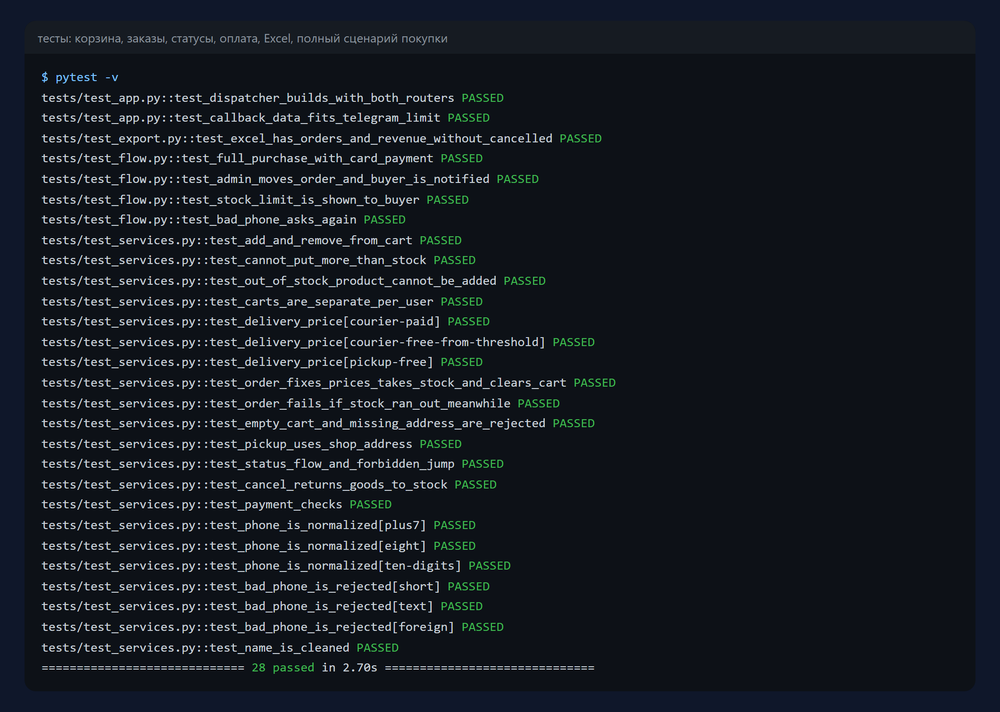

# Бот магазина в Telegram

Готовый магазин внутри Telegram: каталог с разделами, карточки товаров,
корзина, оформление заказа с доставкой или самовывозом, оплата картой через
Telegram Payments или при получении, уведомления и админка для владельца с
выгрузкой заказов в Excel. Демо-каталог — магазин свежей обжарки кофе.

Python 3.11+ · aiogram 3 · SQLAlchemy 2 · openpyxl · pytest

| Каталог и товар | Оформление | Оплата |
|---|---|---|
|  |  |  |

## Покупатель

- каталог по разделам, карточка товара с ценой и остатком;
- корзина: плюс/минус прямо в карточке и в корзине, нельзя положить больше,
  чем есть на складе; подсказка, сколько осталось до бесплатной доставки;
- оформление по шагам: имя → телефон (кнопкой «Отправить номер» или текстом) →
  курьер или самовывоз → адрес → способ оплаты → проверка заказа;
- оплата картой через Telegram Payments (ЮKassa, Сбер и другие провайдеры
  из @BotFather) или при получении;
- «Мои заказы» со статусами и уведомления, когда статус меняется.

## Владелец

- уведомление о каждом новом и каждом оплаченном заказе с кнопками действий;
- `/admin`: заказы и выручка за сегодня, сколько ждут обработки;
- карточка заказа и смена статуса: подтвердить → отправлен → получен или отмена
  (отмена возвращает товар на склад, недопустимые переходы запрещены);
- выгрузка всех заказов в Excel — с фильтрами, форматом денег и выручкой без
  отменённых.

| Админка | Выгрузка в Excel |
|---|---|
|  |  |

## Надёжность

- деньги хранятся в копейках — без ошибок округления;
- в заказе фиксируются название и цена на момент покупки: если товар потом
  подорожает, старые заказы не меняются;
- остатки списываются при оформлении и проверяются ещё раз — если товар
  раскупили, пока покупатель думал, заказ не создастся;
- перед списанием денег (`pre_checkout`) бот проверяет, что заказ свой, ещё не
  оплачен и сумма не изменилась — дважды за один заказ не возьмёт.

## Запуск

```bash
pip install -r requirements.txt
cp .env.example .env        # впишите BOT_TOKEN и свой id в ADMIN_IDS
python -m app.main          # при первом запуске создаст демо-каталог
```

Чтобы включить оплату картой, получите токен провайдера в @BotFather
(Payments) и впишите его в `PAYMENT_PROVIDER_TOKEN`. Без токена бот работает
с оплатой при получении.

## Тесты

```bash
pytest -v
```

28 тестов: корзина и остатки, доставка, оформление и фиксация цен, статусы и
отмена, проверки оплаты, телефон и имя, Excel. Отдельный тест проводит полную
покупку через настоящие обработчики бота — от `/start` до оплаты и смены
статуса админом; подменены только Telegram и база.



## Структура

```
app/services.py        логика магазина без Telegram: каталог, корзина, заказы, статусы
app/handlers_user.py   покупатель: каталог, корзина, оформление, оплата
app/handlers_admin.py  владелец: сводка, заказы, статусы, Excel
app/texts.py           все тексты бота
app/keyboards.py       кнопки и их данные
app/export.py          выгрузка заказов в Excel
app/models.py          товары, корзины, заказы
app/seed.py            демо-каталог
tests/                 тесты и подмена Telegram для сквозного сценария
```

## Лицензия

MIT — см. [LICENSE](LICENSE).
